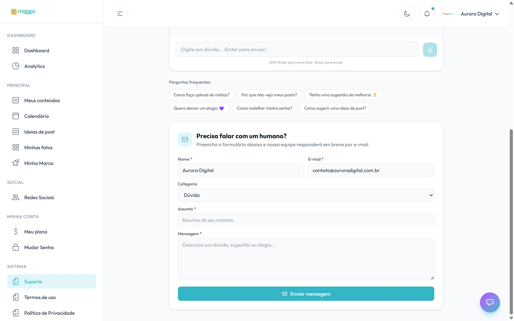

Dentro da plataforma, o **Suporte** tem um assistente que responde na hora e um
formulário para falar com a equipe Miggo.

[Abrir o Suporte →](https://app.miggomkt.com.br/app/support)

<Frame caption="O assistente responde na hora; o formulário abaixo envia a sua mensagem para a equipe.">
  
</Frame>

## Perguntar ao assistente

1. No menu, clique em **Suporte**.
2. Digite a sua dúvida no chat da **Miggo AI** e tecle Enter.

O assistente responde a qualquer hora sobre como usar a plataforma. Você também
pode deixar elogios e sugestões de melhoria por ali.

## Falar com uma pessoa

1. No **Suporte**, clique em **E-mail humano** ou desça até **Precisa falar com um
   humano?**.
2. Preencha **Nome**, **E-mail**, **Categoria**, **Assunto** e **Mensagem**.
3. Clique em **Enviar mensagem**.

Você recebe uma confirmação por e-mail, e a equipe responde por e-mail. Quando a
resposta chega, você também é avisado nas notificações.

Situações que pedem a equipe:

- Erro que se repete e não se resolve reconectando a rede.
- Cobrança ou assinatura.
- Mudança no calendário ou no estilo visual.
- Reclamação sobre a qualidade de um post.

## Sem acesso à plataforma

Não consegue entrar? Escreva para
[oie@miggomkt.com.br](mailto:oie@miggomkt.com.br) a partir do e-mail cadastrado.
