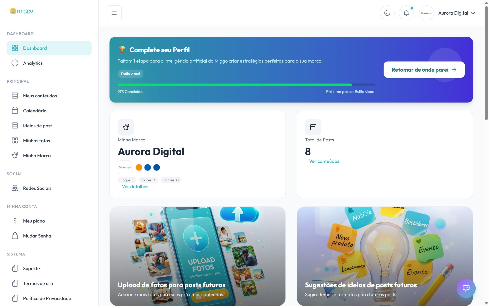

O menu lateral da plataforma reúne todas as áreas. Esta página explica para que
serve cada uma.

<Frame caption="Meu painel reúne o resumo da sua marca, os próximos conteúdos e o status da assinatura.">
  
</Frame>

## Dashboard

| Item | Para que serve |
| --- | --- |
| **Meu painel** | Tela inicial, com o resumo da sua conta. |
| **Meus resultados** | Desempenho das publicações. Veja [Acompanhar meus resultados](/resultados/acompanhar-meus-resultados). |

## Principal

| Item | Para que serve |
| --- | --- |
| **Meus conteúdos** | Os seus posts, semana a semana. É onde você aprova. Veja [Acompanhar meus conteúdos](/conteudo/acompanhar-meus-conteudos). |
| **Meu calendário** | Dias, horários e formatos planejados. Veja [Entender meu calendário](/conteudo/entender-meu-calendario). |
| **Ideias de conteúdo** | Envie sugestões de post para a equipe Miggo. Veja [Sugerir uma ideia de conteúdo](/conteudo/sugerir-uma-ideia-de-conteudo). |
| **Minhas fotos** | O seu acervo de imagens, vídeos e PDFs. Veja [Enviar fotos e vídeos](/conteudo/enviar-fotos-e-videos). |
| **Minha marca** | As informações da sua marca, que orientam todo o conteúdo. Veja [Revisar as informações da marca](/marca/revisar-informacoes-da-marca). |
| **Meus benefícios** | Vantagens de parceiros para assinantes. Veja [Usar os benefícios de assinante](/conta/usar-beneficios-de-assinante). |

## Social

| Item | Para que serve |
| --- | --- |
| **Redes Sociais** | Conectar as redes de publicação e ativar o WhatsApp. Veja [Conectar uma rede social](/redes/conectar-uma-rede-social). |

## Minha Conta

| Item | Para que serve |
| --- | --- |
| **Meu plano** | Assinatura, pagamento e faturas. Veja [Assinar ou trocar de plano](/conta/assinar-ou-trocar-de-plano). |
| **Mudar Senha** | Troca de senha com código enviado por e-mail. Veja [Redefinir a senha](/conta/redefinir-senha). |

## Sistema

| Item | Para que serve |
| --- | --- |
| **Suporte** | Assistente da Miggo e chamado com a equipe. Veja [Falar com o suporte](/ajuda/falar-com-o-suporte). |
| **Central de ajuda** | Esta central, aberta em uma nova aba. |
| **Termos de uso** e **Política de Privacidade** | Documentos legais da plataforma. |

## No celular

No celular, o menu fica numa barra na parte de baixo da tela, com **Início**,
**Conteúdos** e **Calendário**. Os outros itens ficam em **Mais**.
