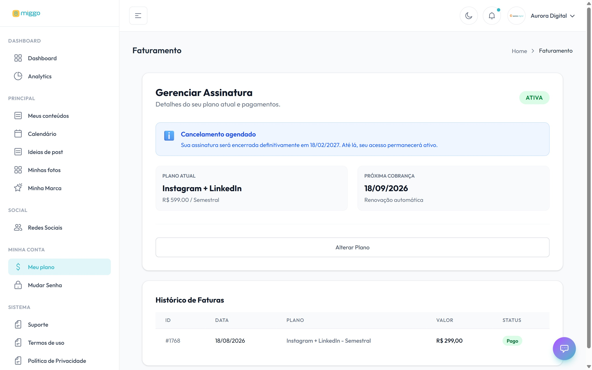

O plano define quantos posts a Miggo produz, em quais redes e em quais formatos.
Você assina e acompanha tudo em **Meu plano**.

[Abrir Meu plano →](https://app.miggomkt.com.br/app/billing)

<Frame caption="O plano atual, a próxima cobrança e o histórico de faturas.">
  
</Frame>

## Assinar um plano

1. No menu, clique em **Meu plano**.
2. Clique em **Efetivar Assinatura (Pagar Agora)**, se você está no teste, ou em
   **Ver Planos**.
3. Escolha a cobrança **Semestral** ou **Trimestral**.
4. No plano escolhido, clique em **Assinar Agora** (ou **Efetivar Assinatura**).
5. Confira o resumo e clique em **Ir para Pagamento Seguro (Stripe)**.
6. Leia os termos e clique em **Li e Aceito os Termos**.
7. Pague no ambiente seguro da Stripe. Tem cupom? Informe na tela de pagamento.

Você volta para a plataforma com **Assinatura Confirmada!**. A assinatura é ativada
sozinha, sem você precisar avisar ninguém.

## Trocar de plano

- **No teste gratuito:** em **Meu plano**, clique em **Trocar Plano do Trial** e
  escolha o novo plano.
- **Com assinatura ativa:** a troca direta não está disponível. Cancele a
  assinatura atual e assine o novo plano depois, ou fale com o
  [suporte](/ajuda/falar-com-o-suporte).

Mudar de plano pode mudar o seu calendário, porque o volume de posts muda.

## Ver as faturas

Em **Meu plano**, o **Histórico de Faturas** lista cada cobrança com plano, valor,
datas e situação: **Pago**, **Pendente**, **Vencida**, **Não pago** ou
**Cancelado**.

## Problemas comuns

| Mensagem | O que fazer |
| --- | --- |
| **Pagamento não concluído** | O pagamento não foi confirmado. Clique em **Concluir Pagamento**. |
| **Pagamento em processamento** | A confirmação ainda não chegou. Não pague de novo: costuma se resolver em poucos minutos. |
| **Pagamento Cancelado / Não Concluído** | Nada foi cobrado. Clique em **Tentar Novamente**. |
| **Você já possui uma assinatura ativa** | Para trocar de plano, cancele a atual ou aguarde o fim do período. |
