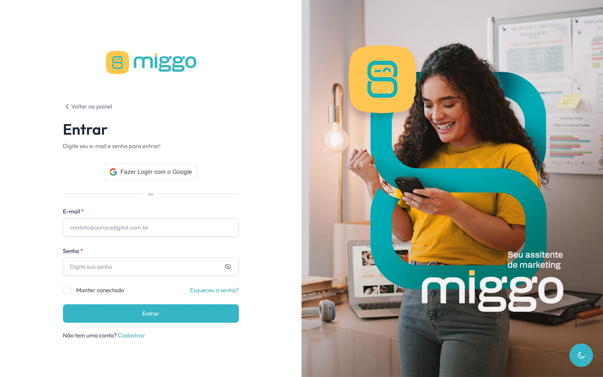

Você entra na Miggo com o e-mail e a senha do cadastro ou com a sua conta Google.

<Frame caption="A tela de entrada, por e-mail e senha ou pela conta Google.">
  
</Frame>

## Com e-mail e senha

1. Acesse [app.miggomkt.com.br/signin](https://app.miggomkt.com.br/signin).
2. Digite o **E-mail** e a **Senha**.
3. Se o computador é só seu, marque **Manter conectado**.
4. Clique em **Entrar**.

Você entra em **Meu painel**.

## Com o Google

1. Na tela de entrada, clique no botão do Google.
2. Escolha a conta Google com o mesmo e-mail do seu cadastro.

Você entra em **Meu painel**.

## Sair da conta

Clique na sua foto, no canto superior direito, e depois em **Desconectar**. Faça
isso sempre que usar um computador compartilhado.

## Problemas comuns

| O que acontece | O que fazer |
| --- | --- |
| Esqueci a senha | Clique em **Esqueceu a senha?**. Veja [Redefinir a senha](/conta/redefinir-senha). |
| **Não foi possível entrar com o Google** | Tente de novo ou entre com e-mail e senha. |
| Outro problema para entrar | Veja [Não consigo entrar na conta](/ajuda/nao-consigo-entrar). |

Ainda não tem conta? Clique em **Cadastrar**. Veja [Criar a sua conta](/comecar/criar-sua-conta).
