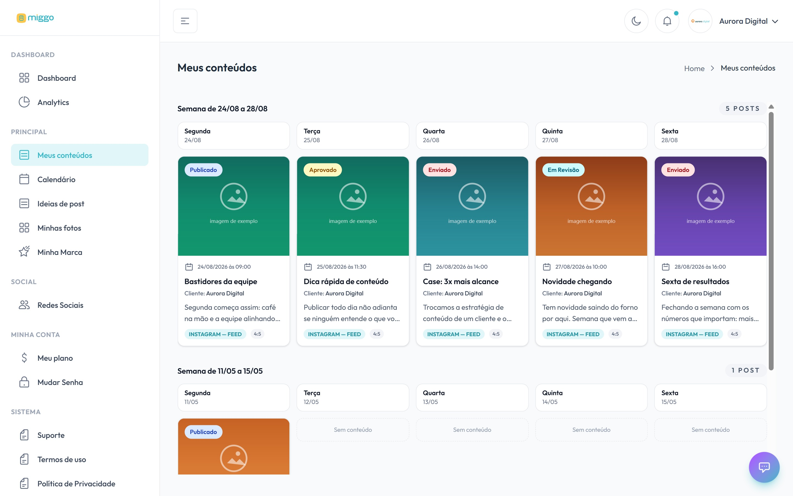

**Meus conteúdos** mostra os seus posts organizados por semana, da mais recente
para a mais antiga. É daqui que você abre cada post para aprovar.

[Abrir Meus conteúdos →](https://app.miggomkt.com.br/app/content)

<Frame caption="Os conteúdos da semana, um dia por coluna.">
  
</Frame>

## Como a tela é organizada

- Cada bloco é uma semana (**Semana de dd/mm a dd/mm**), com o total de posts.
- No computador, a semana aparece em cinco colunas, de segunda a sexta.
- No celular, os posts aparecem em lista, dia a dia. Toque em **Revisar e
  aprovar** para abrir o post.

Cada post mostra a arte, o título, a rede, o formato, a data planejada e a
situação: aguardando a sua aprovação, aprovado ou publicado.

## Abrir um post

1. Clique no post.
2. Leia a legenda inteira e veja todas as imagens.
3. Aprove ou peça um ajuste.

Veja [Como aprovar um post](/conteudo/aprovar-um-post) e
[Como pedir ajuste em um post](/conteudo/pedir-ajuste-em-um-post).

## O que não aparece aqui

Você vê os posts que já estão prontos para você. Um post que você mandou ajustar
sai da lista enquanto a equipe Miggo refaz e volta quando a nova versão chega para
a sua aprovação.

Se a tela mostra **Estamos criando seus primeiros conteúdos**, os primeiros posts
ainda estão sendo produzidos.
