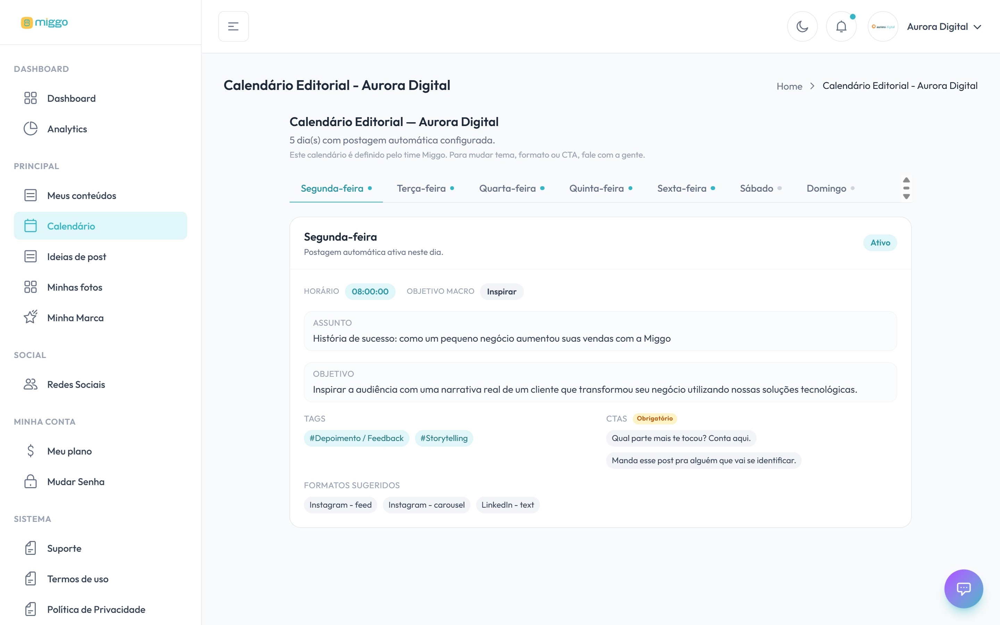

**Meu calendário** mostra o plano das suas publicações: em quais dias da semana
saem posts, em qual horário, sobre qual assunto e em quais formatos.

[Abrir Meu calendário →](https://app.miggomkt.com.br/app/editorial-calendar)

<Frame caption="Cada dia da semana tem uma aba com horário, assunto, tags, chamadas e formatos sugeridos.">
  
</Frame>

## Como ler o calendário

1. No menu, clique em **Meu calendário**.
2. Escolha um dia da semana nas abas. Os dias com post aparecem como **Ativo**.
3. Confira o que está planejado para aquele dia.

| Campo | O que significa |
| --- | --- |
| **Horário** | A hora em que o post daquele dia vai ao ar. |
| **Objetivo macro** | A intenção geral do post, como inspirar, educar ou vender. |
| **Assunto** | O tema do dia. |
| **Objetivo** | O que o post precisa provocar em quem vê. |
| **Tags** | Os temas do post, como `#Depoimento`. |
| **CTAs** | As chamadas para ação. As marcadas como **Obrigatório** precisam aparecer no post. |
| **Formatos sugeridos** | A rede e o formato possíveis para o dia, por exemplo, Instagram e carrossel. |

O calendário foi montado no cadastro, a partir da sua marca, das redes e do volume
de posts do seu plano.

## Mudar dias, horários ou assuntos

O calendário é definido pela equipe Miggo. Para mudar tema, formato, horário ou
chamada, fale com o [suporte](/ajuda/falar-com-o-suporte).

Motivos comuns para pedir uma mudança:

- O horário não bate com o momento em que o seu público está online.
- O seu negócio tem um dia forte que não está sendo aproveitado.
- Você quer concentrar os posts em menos dias.

## Calendário e Meus conteúdos

O calendário mostra o **plano**. [Meus conteúdos](/conteudo/acompanhar-meus-conteudos)
mostra os **posts** já criados. Um post só sai no horário previsto se for aprovado
antes.
