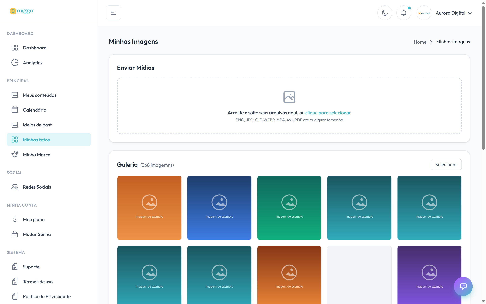

**Minhas fotos** é o seu acervo. A Miggo usa as imagens e os vídeos que você envia
aqui nos próximos posts.

[Abrir Minhas fotos →](https://app.miggomkt.com.br/app/media-library)

<Frame caption="A área de envio e a galeria com o seu acervo.">
  
</Frame>

## Formatos aceitos

- **Imagem:** JPG, PNG, WEBP e GIF
- **Vídeo:** MP4, MOV, AVI, MPEG e WEBM
- **Documento:** PDF

No teste gratuito há um tamanho máximo por imagem e por vídeo. A tela mostra esse
limite logo abaixo da área de envio.

## Passo a passo

1. No menu, clique em **Minhas fotos**.
2. Arraste os arquivos para a área **Enviar Mídias** ou clique nela para
   selecionar. Dá para enviar vários de uma vez.
3. Aguarde o envio terminar.

Você vê a mensagem com o número de arquivos enviados, e eles aparecem na
**Galeria**.

## Problemas comuns

A Miggo confere cada arquivo antes de enviar. Se algum não subir, a tela lista o
arquivo e o motivo, e os outros seguem normalmente. Para cada arquivo da lista, use
**Substituir arquivo** ou **Remover da lista**.

| Mensagem | O que fazer |
| --- | --- |
| **Formato não é aceito** | Converta para um dos formatos acima. Foto HEIC (padrão do iPhone) deve ser convertida para JPG. |
| **O arquivo tem X MB e o máximo é Y MB** | Reduza o tamanho, comprimindo o vídeo ou exportando a foto em resolução menor, e envie de novo. |
| **Falha na conexão** ou **O envio demorou demais** | Confira a internet. Para arquivo grande, use uma conexão mais estável. |
| **O servidor demorou para responder** | Tente de novo em alguns instantes. Se persistir, fale com o [suporte](/ajuda/falar-com-o-suporte). |

## O que enviar

<CardGroup cols={2}>
  <Card title="Produtos e serviços" icon="box">
    Fotos limpas, com boa luz e ângulos variados.
  </Card>
  <Card title="Bastidores" icon="clapperboard">
    O processo, a produção, o dia a dia. É o que mais gera identificação.
  </Card>
  <Card title="Equipe e pessoas" icon="users">
    Rostos deixam a marca mais próxima.
  </Card>
  <Card title="Ambiente" icon="store">
    Loja, escritório, fachada. Mostra onde a marca acontece.
  </Card>
</CardGroup>

## Boas práticas

- **Envie o arquivo original**, não o print nem a foto baixada do WhatsApp. A
  compressão estraga a qualidade da arte.
- **Mande fotos na horizontal e na vertical.** Cada formato de post pede um
  enquadramento.
- **Envie em lote.** Uma sessão de fotos por mês rende posts para várias semanas.
- **Evite imagens com texto.** A Miggo aplica o texto no estilo da sua marca.

<Tip>
  Sem acervo, a Miggo trabalha com o que tem. Um envio de 20 a 30 fotos boas por mês
  costuma mudar a qualidade do feed.
</Tip>
