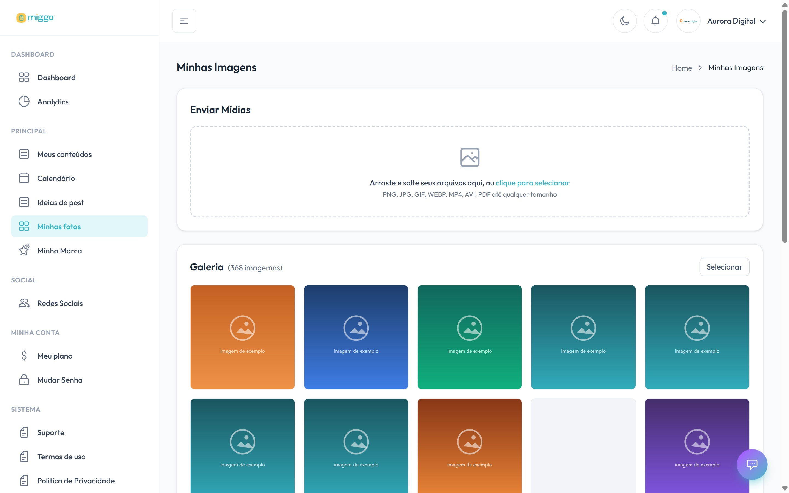

**Minhas fotos** é a sua biblioteca de mídias. Tudo o que você envia aqui fica
disponível para a Miggo usar nos próximos conteúdos.

[Abrir Minhas fotos →](https://app.miggomkt.com.br/app/media-library)

<Frame caption="A área de upload e a galeria com o seu acervo.">
  
</Frame>

## Enviar arquivos

Arraste os arquivos para a área de upload ou clique em **clique para selecionar**.

Logo abaixo da área de upload, a tela mostra os formatos aceitos. Hoje são:

- **Imagem:** JPG, PNG, WEBP e GIF
- **Vídeo:** MP4, MOV, AVI, MPEG e WEBM
- **Documento:** PDF

No teste gratuito há um tamanho máximo por imagem e por vídeo, e a tela mostra
esse limite.

## Quando um arquivo não sobe

A Miggo confere cada arquivo antes de enviar. Se algum não puder subir, a tela
lista o arquivo e o motivo, e os outros seguem normalmente. Os motivos mais
comuns:

| Mensagem | O que fazer |
| --- | --- |
| **Formato não é aceito** | Converta para um dos formatos da lista. Se a foto for HEIC (padrão do iPhone), converta para JPG. |
| **O arquivo tem X MB e o máximo é Y MB** | Reduza o tamanho (comprima o vídeo ou exporte a foto em resolução menor) e envie de novo. |
| **Falha na conexão** ou **O envio demorou demais** | Confira a internet. Para arquivo grande, use uma conexão mais estável. |
| **O servidor demorou para responder** | Tente de novo em alguns instantes. Se persistir, fale com o [suporte](/ajuda/suporte). |

<Note>
  A lista mostra apenas as mídias **ainda não usadas** em nenhum post. Quando uma
  foto entra em uma publicação, ela sai da fila de disponíveis.
</Note>

## O que enviar

A Miggo consegue produzir com banco de imagens, mas conteúdo com foto real da sua
marca performa melhor. Vale a pena manter o acervo abastecido com:

<CardGroup cols={2}>
  <Card title="Produtos e serviços" icon="box">
    Fotos limpas, boa luz, ângulos variados. Se possível, com e sem fundo.
  </Card>
  <Card title="Bastidores" icon="clapperboard">
    O processo, a produção, o dia a dia. É o que mais gera identificação.
  </Card>
  <Card title="Equipe e pessoas" icon="users">
    Rostos humanizam a marca e costumam ter mais alcance.
  </Card>
  <Card title="Ambiente" icon="store">
    Loja, escritório, oficina, fachada. Mostra onde a marca acontece.
  </Card>
</CardGroup>

## Boas práticas

- **Prefira o arquivo original**, não o print ou o download do WhatsApp — a
  compressão estraga a qualidade na arte final.
- **Envie na horizontal e na vertical** quando possível: formatos diferentes de
  post pedem enquadramentos diferentes.
- **Mande em lote.** Uma sessão de fotos por mês rende conteúdo para várias semanas.
- **Evite imagens com texto embutido.** A Miggo aplica o texto no estilo da sua
  marca; texto de origem atrapalha a diagramação.

<Tip>
  Sem acervo, a Miggo trabalha com o que tem. Um upload de 20 a 30 fotos boas por
  mês costuma ser o divisor de águas na qualidade do feed.
</Tip>
