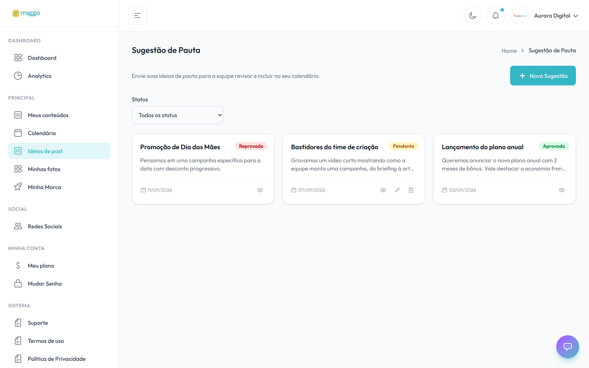

Tem um lançamento, uma promoção ou uma data que só você conhece? Envie como ideia
de conteúdo. A equipe Miggo avalia e encaixa no seu calendário.

[Abrir Ideias de conteúdo →](https://app.miggomkt.com.br/app/agenda/sugestao)

<Frame caption="As ideias enviadas, com a situação de cada uma.">
  
</Frame>

## Passo a passo

1. No menu, clique em **Ideias de conteúdo**.
2. Clique em **Nova Sugestão**.
3. Preencha os campos:
   - **Título da Ideia**: um resumo em uma linha.
   - **Descrição**: o contexto, o que precisa ser dito, preço, prazo, condição.
   - **Data Sugerida para Publicação**: quando você quer que saia.
   - **Formato de Post**: as opções aparecem depois que você escolhe a data.
   - **Mídia**: imagens, vídeos ou PDFs de apoio, até 50 MB cada (opcional).
4. Clique em **Enviar Sugestão**.

A ideia aparece na lista como **Pendente**.

## Acompanhar as suas ideias

A lista mostra a situação de cada ideia:

| Situação | O que significa |
| --- | --- |
| **Pendente** | A equipe Miggo ainda vai avaliar. Você ainda pode editar ou excluir. |
| **Aprovado** | A ideia vai virar post no seu calendário. |
| **Reprovado** | A ideia não entrou. Abra a ideia para ver o **Feedback da Equipe**. |

Use o filtro **Status** para ver só uma situação.

## Como aumentar a chance de aprovação

- **Envie com antecedência.** Ideias para datas muito próximas podem não caber no
  calendário.
- **Anexe material.** Fotos do produto, do evento ou da equipe aceleram a produção.
- **Seja concreto.** Diga o que precisa aparecer: preço, prazo, nome do produto.

Algo deu errado? Veja [Não consigo enviar uma ideia](/ajuda/nao-consigo-enviar-ideia).
