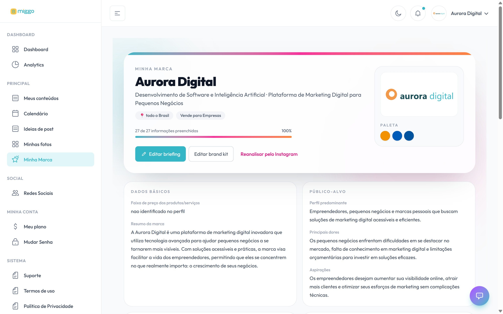

**Minha marca** guarda tudo o que a Miggo sabe sobre o seu negócio: público, tom de
voz, produtos, diferenciais e objetivos. Cada título, legenda e arte parte daqui.

[Abrir Minha marca →](https://app.miggomkt.com.br/app/briefing)

<Frame caption="O resumo da marca, com o progresso do preenchimento.">
  
</Frame>

## Passo a passo

1. No menu, clique em **Minha marca**.
2. Clique em **Editar briefing**.
3. Abra cada seção e ajuste o que precisar: **Dados básicos**, **Público-alvo**,
   **Tom de voz**, **Produtos e serviços**, **Diferenciais**, **Objetivos e
   chamadas para ação** e as demais.
4. Clique em **Salvar briefing**.

Você vê a mensagem **Salvo com sucesso!**. Os próximos conteúdos já usam a nova
versão.

## Completar o que falta

No resumo, a área **Ainda não preenchidos** lista os campos vazios. Clique em
**Completar** para preencher. Quanto mais completo, mais o conteúdo fica com a cara
da sua marca.

## Quando atualizar

- Você mudou o público-alvo ou entrou em um novo segmento.
- Lançou uma linha nova de produtos ou serviços.
- O objetivo do conteúdo mudou, por exemplo, de reconhecimento para venda.

<Tip>
  Se vários posts saem com um tom que não parece a sua marca, ajuste o **Tom de
  voz** aqui. A correção vale para todos os próximos posts, não só para um.
</Tip>

## Veja também

- [Atualizar a marca pelo Instagram](/marca/atualizar-marca-pelo-instagram)
- [Enviar materiais da marca](/marca/enviar-materiais-da-marca)
