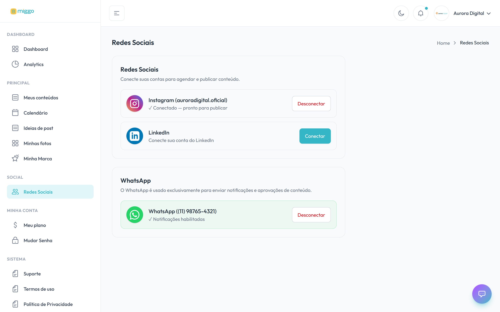

Com a rede conectada, a Miggo publica os seus posts sozinha, no horário planejado.
Sem ela, a Miggo cria o conteúdo, mas você precisa publicar por conta própria.

[Abrir Redes Sociais →](https://app.miggomkt.com.br/app/social-networks)

<Frame caption="As contas para publicação e o WhatsApp, cada um no seu card.">
  
</Frame>

## Quais redes aparecem

Em **Contas para publicação** aparecem as redes liberadas para a sua conta, como
Instagram, Facebook, LinkedIn e TikTok. Se a rede que você quer não está na lista,
fale com o [suporte](/ajuda/falar-com-o-suporte).

## Passo a passo

1. No menu, clique em **Redes Sociais**.
2. No card da rede, clique em **Conectar**.
3. Você é levado para o site da rede. Entre com a sua conta e autorize o acesso da
   Miggo.
4. Ao voltar, a plataforma mostra **Conexão recebida**.
5. Volte para **Redes Sociais** e confira o card.

Quando a rede confirma, o card mostra o nome do perfil e **Conectado — pronto para
publicar**.

<Note>
  A autorização acontece no site da própria rede. A Miggo nunca pede a sua senha.
  Veja [Segurança da conta](/ajuda/seguranca-da-conta).
</Note>

<Tip>
  Prefira conectar pelo computador. No celular, a rede pode abrir o aplicativo em
  vez do navegador e travar a autorização. Veja
  [Conectar uma rede pelo celular](/redes/conectar-pelo-celular).
</Tip>

## Problemas comuns

| O card mostra | O que fazer |
| --- | --- |
| **Aguardando a confirmação da rede para ativar a conexão.** | A rede ainda não confirmou. Aguarde alguns minutos. Se não mudar, clique em **Aguardando confirmação** e termine a autorização no site da rede. |
| **Nenhuma rede disponível para conectar.** | Nenhuma rede de publicação foi liberada para a sua conta. Fale com o [suporte](/ajuda/falar-com-o-suporte). |
| A conexão não funciona | Veja [Erro ao conectar uma rede](/ajuda/erro-ao-conectar-rede). |
