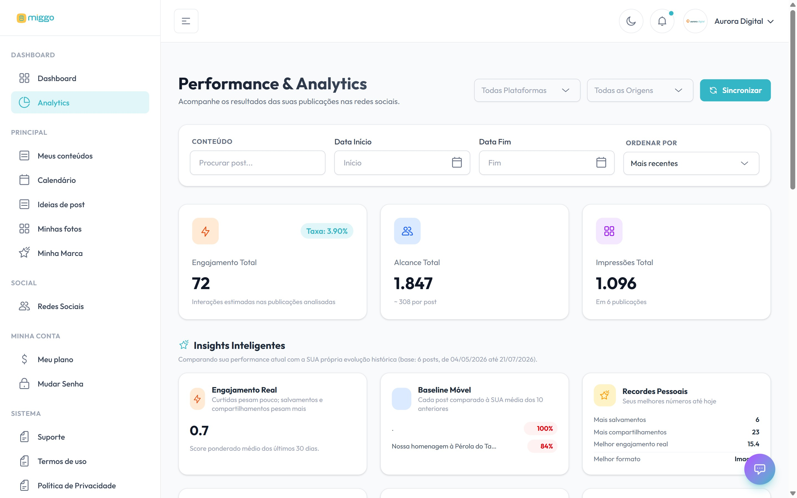

**Meus resultados** mostra o desempenho das suas publicações nas redes conectadas:
alcance, impressões, engajamento e seguidores.

[Abrir Meus resultados →](https://app.miggomkt.com.br/app/analytics)

<Frame caption="Os totais do período, os insights e o detalhe de cada post.">
  
</Frame>

## Passo a passo

1. No menu, clique em **Meus resultados**.
2. Use os filtros para escolher o que ver:
   - **Plataforma**: uma rede ou todas.
   - **Origem**: **Publicados pela Miggo** ou **Externos (orgânicos)**, os posts
     que você publicou por fora.
   - **Data Início** e **Data Fim**: o período.
3. Confira os totais e, abaixo, a tabela **Detalhamento de Posts**. Ordene por
   data, alcance, curtidas ou engajamento.

## O que cada bloco mostra

| Bloco | O que mostra |
| --- | --- |
| **Engajamento Total** | As interações nas publicações analisadas e a taxa de engajamento. |
| **Alcance Total** | Quantas pessoas viram as publicações, com a média por post. |
| **Impressões Total** | Quantas vezes as publicações foram exibidas. |
| **Insights Inteligentes** | O seu desempenho comparado com a sua própria evolução e os seus recordes. |
| **Evolução Diária** | Os últimos 90 dias, incluindo publicações externas. |
| **Crescimento de Seguidores** | A evolução dos seguidores. |

## Problemas comuns

| A tela mostra | O que fazer |
| --- | --- |
| **Conecte suas redes para ver seus resultados** | Os resultados vêm das redes conectadas. Clique em **Conectar redes sociais**. Veja [Conectar uma rede social](/redes/conectar-uma-rede-social). |
| **Nenhum dado encontrado** | Mude os filtros ou aguarde: os dados das redes chegam com algum atraso. |

## Meu painel

**Meu painel** é a tela inicial. Ele resume a sua conta: a sua marca, o total de
posts, as redes conectadas, o plano e o calendário. Use os atalhos para enviar
fotos e sugerir ideias.
